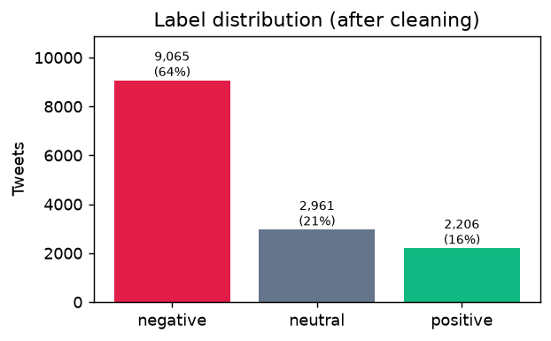
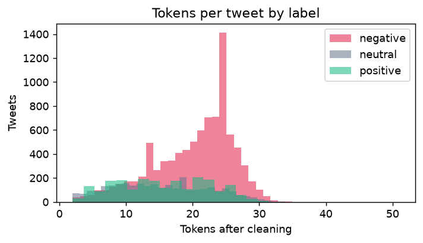
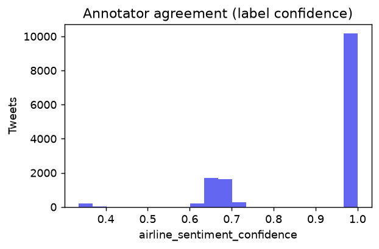

# Exploratory Data Analysis

Generated by `python -m sentiment_ml.pipeline`. Dataset: [Twitter US Airline Sentiment (CrowdFlower / Figure Eight)](https://www.kaggle.com/datasets/crowdflower/twitter-airline-sentiment) (licence: CC BY-NC-SA 4.0).

## 1. Schema

| Column | Type | Missing | Missing % |
|---|---|---|---|
| tweet_id | int64 | 0 | 0.0% |
| airline_sentiment | str | 0 | 0.0% |
| airline_sentiment_confidence | float64 | 0 | 0.0% |
| negativereason | str | 5,462 | 37.3% |
| negativereason_confidence | float64 | 4,118 | 28.1% |
| airline | str | 0 | 0.0% |
| airline_sentiment_gold | str | 14,600 | 99.7% |
| name | str | 0 | 0.0% |
| negativereason_gold | str | 14,608 | 99.8% |
| retweet_count | int64 | 0 | 0.0% |
| text | str | 0 | 0.0% |
| tweet_coord | str | 13,621 | 93.0% |
| tweet_created | str | 0 | 0.0% |
| tweet_location | str | 4,733 | 32.3% |
| user_timezone | str | 4,820 | 32.9% |

Only `text` (input) and `airline_sentiment` (label) are used for training. `airline_sentiment_confidence` is used for error analysis (label noise). Columns such as `tweet_coord`, `negativereason_gold` and `airline_sentiment_gold` are mostly empty and unused.

## 2. Data quality and cleaning

| Step | Rows |
|---|---|
| rows raw | 14,640 |
| text artifacts repaired | 1,552 |
| missing text | 0 |
| missing label | 0 |
| empty text | 0 |
| invalid label | 0 |
| duplicate tweet id | 155 |
| duplicate raw text | 58 |
| empty after cleaning | 0 |
| conflicting label duplicates dropped | 153 |
| duplicate clean text dropped | 100 |
| rows final | 14,232 |

- **Find-and-replace artifacts (repaired):** the published CSV replaced every `late` and `cancel` (and some `book`) substrings with complaint-category names, even inside other words. The natural words *late* and *cancel* appear zero times, so a model trained on the raw text would never learn them. We reverse the substitution before cleaning:

| Repair | Tweets affected | Examples |
|---|---|---|
| `Cancelled Flight` → `cancel` | 1,020 | `Cancelled Flightled` → `cancelled`, `Cancelled Flighted` → `canceled`, `Cancelled Flight` → `cancel` |
| `Late Flight` → `late` | 451 | `Late Flight` → `late`, `Late Flightr` → `later`, `reLate Flightd` → `related` |
| `Flight Booking Problems` → `book` | 145 | `Flight Booking Problems` → `book`, `reFlight Booking Problems` → `rebook`, `overFlight Booking Problems` → `overbook` |

- **Duplicate tweet IDs** were scraped twice; one copy is kept.
- **Conflicting-label duplicates**: the same cleaned text labelled differently by annotators. Every copy is dropped because neither label can be trusted.
- **Cleaned-text duplicates** (e.g. the same message sent to two airlines) are dropped *before* the split so an identical input cannot appear in both train and test (leakage).

### Text quality (raw tweets)

| Feature | Share of tweets |
|---|---|
| Contains a URL | 8.0% |
| Contains an @mention | 100.0% |
| Contains a #hashtag | 16.2% |
| Contains a text emoticon like :) or :( | 10.5% |
| Contains an ALL-CAPS word (3+ letters) | 19.4% |
| Contains an elongated word (e.g. sooo) | 0.7% |
| Contains HTML entities (&amp; etc.) | 4.9% |
| Contains an emoji | 3.4% |

## 3. Label distribution

| Label | Tweets | Share |
|---|---|---|
| negative | 9,065 | 63.7% |
| neutral | 2,961 | 20.8% |
| positive | 2,206 | 15.5% |

The classes are **imbalanced** (negative is the majority). A model that always answers *negative* would already reach about this share in accuracy while being useless, which is why macro-F1 is the headline metric and class weights are evaluated during training.

The original labels are already Negative / Neutral / Positive, so no label mapping was needed (they are only lower-cased).

## 4. Text length

| Label | Median characters | Median tokens |
|---|---|---|
| negative | 124 | 21 |
| neutral | 87 | 15 |
| positive | 89 | 16 |

Negative tweets are longer: complaints come with explanations; praise tends to be short.

## 5. Most common words per label

(Stop words hidden in this table for readability only. The model keeps them, including negations.)

| Label | Top tokens (count) |
|---|---|
| negative | flight (2491), not (1348), no (1318), service (761), hours (640), just (619), customer (614), help (613), hold (610), time (595), plane (525), i'm (511), delayed (502), hour (450), can't (448) |
| neutral | flight (536), just (169), flights (164), need (160), help (160), not (149), thanks (142), i'm (121), dm (117), no (113), tomorrow (106), fleek (97), know (95), time (95), fleet's (91) |
| positive | thanks (547), thank (399), flight (356), great (233), just (175), service (163), love (137), <smile> (122), customer (114), guys (106), :folded_hands: (106), good (105), best (100), time (97), awesome (95) |

## 6. Sentiment by airline

Each airline has a very different mix. A model that saw the airline handle could learn "@united means negative", a shortcut that would not transfer to other brands. That is why @mentions are replaced by `<user>` during cleaning.

| Airline | Tweets | negative | neutral | positive |
|---|---|---|---|---|
| American | 2,562 | 72.6% | 16.4% | 11.0% |
| Delta | 2,147 | 44.3% | 31.6% | 24.0% |
| Southwest | 2,374 | 49.8% | 27.0% | 23.1% |
| US Airways | 2,873 | 78.7% | 12.7% | 8.6% |
| United | 3,785 | 69.5% | 18.2% | 12.3% |
| Virgin America | 491 | 36.7% | 34.0% | 29.3% |

## 7. Label quality

- 71.5% of tweets have full annotator agreement (confidence = 1.0).
- 26.3% have confidence below 0.7. These labels are noisy, which caps the accuracy any model can reach and is analysed in the evaluation report.

### Why customers were negative (annotated reasons, not used for training)

| Reason | Tweets |
|---|---|
| Customer Service Issue | 2,879 |
| Late Flight | 1,649 |
| Can't Tell | 1,167 |
| Cancelled Flight | 829 |
| Lost Luggage | 719 |
| Bad Flight | 575 |
| Flight Booking Problems | 522 |
| Flight Attendant Complaints | 475 |

## 8. Timestamps

Tweets were posted between **2015-02-17** and **2015-02-24** (about one week). These dates are *not* used by the dashboard: its date filters use the time each prediction was made, as required by the brief. We never fabricate timestamps.

## 9. Train / test split

Stratified 80% / 20% split with `random_state=42`, done after cleaning and de-duplication and **before** any vectoriser is fitted.

| Split | Rows | negative | neutral | positive |
|---|---|---|---|---|
| train | 11,385 | 63.7% | 20.8% | 15.5% |
| test | 2,847 | 63.7% | 20.8% | 15.5% |

## 10. Cleaning examples

| Raw tweet | Cleaned (what the model sees) |
|---|---|
| @united it's 9:56, and the desk attendant stated we would "sit awhile" until given the all clear. Lack of communication seems to the norm. | \<user\> it's 9 56 and the desk attendant stated we would sit awhile until given the all clear lack of communication seems to the norm |
| @USAirways you can thank supervisor Jeanine and her coworkers for the excellent customer service they provided | \<user\> you can thank supervisor jeanine and her coworkers for the excellent customer service they provided |
| @JetBlue nope. Currently sitting at my gate. | \<user\> nope currently sitting at my gate |
| @SouthwestAir did you cancel ALL flights into BNA today??? #needtogethome | \<user\> did you cancel all flights into bna today ? needtogethome |
| @USAirways Oh well. I'll get to Cancun eventually. | \<user\> oh well i'll get to cancun eventually |
| @AmericanAir flight AA1119, cx to AA157. Killing my layover, still wanting breakfast. I'm hungry! Get me to DFW! | \<user\> flight aa1119 cx to aa157 killing my layover still wanting breakfast i'm hungry ! get me to dfw ! |
