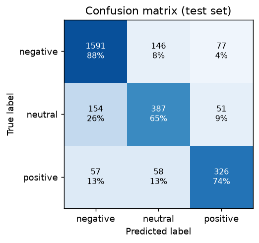
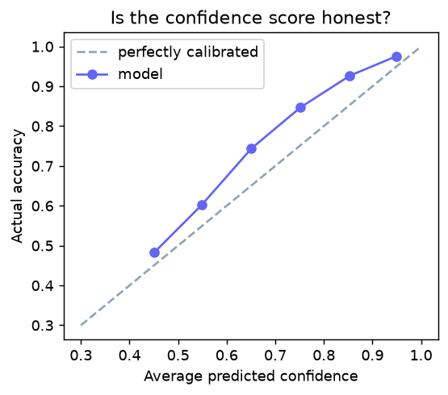

# Evaluation Report

Model **tfidf-logreg@1.0.0+9cb76b11**, generated by `python -m sentiment_ml.pipeline` (seed 42, scikit-learn 1.9.1).

## 1. Headline

- **Macro-F1 on the held-out test set: 0.754** (accuracy 0.809).
- A dummy model that always predicts the majority class scores macro-F1 0.259 with accuracy 0.637. Its high accuracy shows why accuracy alone is misleading on imbalanced data.
- **Why macro-F1 is the headline metric:** it averages F1 over the three classes with equal weight, so the model cannot score well by doing well only on the 64% negative majority. F1 itself balances precision (when it says positive, is it right?) and recall (does it find the positive posts?).

## 2. Setup

- Data: 14,640 raw tweets → 14,232 after validation and de-duplication (see `reports/eda.md`).
- Stratified split: 11,385 train / 2,847 test, made before any vectoriser was fitted.
- All model and cleaning choices were made with 5-fold stratified cross-validation on the train split (scoring: macro-F1). The test split was used once, for this report.
- Selection rule: serve Logistic Regression unless another candidate beats it by more than 0.01 CV macro-F1 (Logistic Regression provides real probabilities and exact per-word explanations).

## 3. Model comparison

| Model | CV macro-F1 (mean ± std) | Test macro-F1 | Test accuracy | Best settings | Served |
|---|---|---|---|---|---|
| Dummy (always majority class) | 0.259 ± 0.000 | 0.259 | 0.637 | – |  |
| TF-IDF + Complement Naive Bayes | 0.735 ± 0.009 | 0.722 | 0.795 | alpha=0.3, ngram_range=(1, 2) |  |
| TF-IDF + Linear SVM | 0.755 ± 0.008 | 0.761 | 0.820 | C=0.3, ngram_range=(1, 2) |  |
| TF-IDF + Logistic Regression | 0.758 ± 0.009 | 0.754 | 0.809 | C=2.0, class_weight=balanced, min_df=1, ngram_range=(1, 2) | ✅ |
| TF-IDF words + character n-grams + Logistic Regression | 0.761 ± 0.008 | 0.763 | 0.810 | C=1.0 |  |

The best CV score belongs to **TF-IDF words + character n-grams + Logistic Regression**, 0.003 above Logistic Regression, which is within the tolerance, so Logistic Regression is served for its probabilities and explainability.

## 4. Class imbalance

Logistic Regression was tuned with and without balanced class weights (balanced = mistakes on rare classes cost more during training):

| Class weights | Best CV macro-F1 |
|---|---|
| balanced | 0.758 ± 0.009 |
| none | 0.741 ± 0.007 |

Selected: **balanced**. We use class weights rather than resampling: no duplicated or synthetic tweets, nothing extra to explain, and the effect is visible in minority-class recall below.

## 5. Cleaning ablation (which cleaning steps help or hurt?)

Each row changes ONE cleaning step and re-runs 5-fold CV with the selected model settings.

| Change | CV macro-F1 | Δ vs. production |
|---|---|---|
| Production cleaning (all steps as designed) | 0.7585 ± 0.0091 | – |
| Keep raw URLs instead of `<url>` | 0.7564 ± 0.0079 | -0.0021 |
| Keep @mentions (brand handles) instead of `<user>` | 0.7557 ± 0.0083 | -0.0028 |
| Delete hashtags instead of keeping their words | 0.7558 ± 0.0077 | -0.0027 |
| Delete emojis instead of converting them to names | 0.7563 ± 0.0101 | -0.0022 |
| Delete text emoticons like :) instead of converting | 0.7557 ± 0.0083 | -0.0028 |
| Delete ! and ? | 0.7488 ± 0.0096 | -0.0097 |
| Keep elongations (sooo) as-is | 0.7584 ± 0.0084 | -0.0001 |
| ADD negation marking (not good -> not neg_good) | 0.7562 ± 0.0100 | -0.0023 |
| Minimal cleaning (lowercase + split only) | 0.7415 ± 0.0086 | -0.0170 |

Δ values smaller than the CV standard deviation are within noise. Steps are kept for a principled reason even when their measured effect is small (see the README's cleaning table).

## 6. Test-set results (served model)



| Class | Precision | Recall | F1 | Support |
|---|---|---|---|---|
| negative | 0.883 | 0.877 | 0.880 | 1814 |
| neutral | 0.655 | 0.654 | 0.654 | 592 |
| positive | 0.718 | 0.739 | 0.729 | 441 |

| Average | Precision | Recall | F1 |
|---|---|---|---|
| macro | 0.752 | 0.757 | 0.754 |
| weighted | – | – | 0.810 |

Rows of the confusion matrix are the true labels and columns the predictions; the percentage is the share of that true class.

## 7. Confidence: can we trust the score?



| Confidence band | Predictions | Share | Avg confidence | Actual accuracy |
|---|---|---|---|---|
| 0.33–0.50 | 292 | 10.3% | 0.45 | 48.3% |
| 0.50–0.60 | 384 | 13.5% | 0.55 | 60.2% |
| 0.60–0.70 | 410 | 14.4% | 0.65 | 74.4% |
| 0.70–0.80 | 491 | 17.2% | 0.75 | 84.7% |
| 0.80–0.90 | 571 | 20.1% | 0.85 | 92.6% |
| 0.90–1.00 | 699 | 24.6% | 0.95 | 97.6% |

Log loss 0.499, multi-class Brier score 0.279 (lower is better). Higher confidence does mean higher accuracy, but the values are estimates, which is why the UI labels them as such and flags predictions below 0.55 as low confidence (676 test posts).

## 8. Label noise

Accuracy of the served model grouped by how much the human annotators agreed:

| Annotator agreement | Test tweets | Model accuracy |
|---|---|---|
| confidence = 1.0 (annotators fully agreed) | 2008 | 88.8% |
| 0.7 ≤ confidence < 1.0 | 71 | 56.3% |
| confidence < 0.7 (noisy label) | 768 | 62.5% |

When humans disagree, the 'correct' answer is uncertain too; part of the error rate is label noise rather than model failure.

## 9. Domain shift check

The same model scored on 12,271 general tweets (TweetEval sentiment test split, SemEval-2017): **macro-F1 0.483**, accuracy 0.490. Performance falls substantially outside the airline domain. This is the clearest evidence for the model's main limitation.

## 10. Error analysis

543 of 2,847 test tweets are misclassified (19.1%).

### Which mistakes are most common?

| True → predicted | Errors |
|---|---|
| neutral → negative | 154 |
| negative → neutral | 146 |
| negative → positive | 77 |
| positive → neutral | 58 |
| positive → negative | 57 |
| neutral → positive | 51 |

### Heuristic pattern tags across all errors

(A tweet can have several tags. Tags suggest a reason; the reviewed examples below confirm them.)

| Pattern | Errors | Share of errors |
|---|---|---|
| label noise (annotators disagreed) | 288 | 53% |
| mixed sentiment | 231 | 43% |
| question vs. opinion | 144 | 27% |
| negation | 130 | 24% |
| possible sarcasm / polite complaint | 73 | 13% |
| no obvious pattern | 54 | 10% |
| very short / little context | 33 | 6% |

### 24 most confident mistakes (up to 4 per error type)

| True | Predicted | Confidence | Label agreement | Tweet | Tags |
|---|---|---|---|---|---|
| negative | neutral | 0.99 | 0.65 | @united any solutions? | label noise (annotators disagreed), question vs. opinion, very short / little context |
| negative | neutral | 0.94 | 0.66 | @SouthwestAir Flight 4968 (N8325D) departs @MCO enroute to @NO_Airport http://t.co/fd4SnvKIeM | label noise (annotators disagreed) |
| negative | neutral | 0.92 | 1.00 | @united i sure will | very short / little context |
| negative | neutral | 0.90 | 0.66 | @AmericanAir can I get home before 12 or no? | label noise (annotators disagreed), negation, question vs. opinion |
| negative | positive | 0.99 | 0.35 | @SouthwestAir oh, ok!  all good!  looking forward to escaping the cold for a bit!  thanks! | label noise (annotators disagreed), possible sarcasm / polite complaint |
| negative | positive | 0.95 | 1.00 | @AmericanAir thank you for the robotic and non helpful assistance. | mixed sentiment, possible sarcasm / polite complaint |
| negative | positive | 0.93 | 0.68 | @united thanks for having ground crews that are surprised when flights arrive. #beingsuckontarmacsucks! | label noise (annotators disagreed), mixed sentiment, possible sarcasm / polite complaint |
| negative | positive | 0.92 | 0.67 | @USAirways thanks for being so bad you make a two day train trip look appealing!! | label noise (annotators disagreed), possible sarcasm / polite complaint |
| neutral | negative | 0.93 | 1.00 | @united this is for a check-in luggage. Employee told me not to include wheels in the dimensions. | negation |
| neutral | negative | 0.88 | 0.68 | @united no, didn't notice I was 38A until start of boarding. Assumed I was 8E. By time boarding started, GAs had cleared standbys, full flt | label noise (annotators disagreed), negation, mixed sentiment |
| neutral | negative | 0.88 | 0.66 | @AmericanAir we have been rebooked due to weather, but need to change our reservation and fly on the 24th, instead of the 23rd. | label noise (annotators disagreed) |
| neutral | negative | 0.87 | 0.70 | @USAirways I left my personal stuff on US4551 from PHL-BOS about an hour ago. Went baggage, was told plane left to call 800# | mixed sentiment |
| neutral | positive | 1.00 | 0.68 | @united Thank you for your response! | label noise (annotators disagreed), mixed sentiment |
| neutral | positive | 0.99 | 0.36 | @JetBlue thanks anyways @SouthwestAir has my back! Awesome rate &amp; amazing customer service #nomoreaggravation | label noise (annotators disagreed), mixed sentiment |
| neutral | positive | 0.91 | 0.66 | @SouthwestAir k thanks :) | label noise (annotators disagreed), very short / little context |
| neutral | positive | 0.89 | 1.00 | @united thanks for the info I already knew... | no obvious pattern |
| positive | negative | 0.93 | 0.63 | @united That made me so mad, but then I called the bag number, and that person was helpful and told me where the bag really was. (2/2) | label noise (annotators disagreed), mixed sentiment |
| positive | negative | 0.91 | 0.37 | @USAirways after missing my flight and rebook 2x, I just walked onto another flight and my phone was still on the seat!! | label noise (annotators disagreed), mixed sentiment |
| positive | negative | 0.88 | 0.34 | @united not just refunded, but for those of us who are on vacation to get a free room night to make up for making us sleep in DIA | label noise (annotators disagreed), negation, mixed sentiment |
| positive | negative | 0.84 | 1.00 | @SouthwestAir Thx to customer service rep ALEX for his patient help in rebook a canceled flight and getting us where we have to be tmrw! | mixed sentiment |
| positive | neutral | 0.95 | 0.65 | @JetBlue Airways Reveals 'Bluemanity' Livery - TravelPulse http://t.co/fTTfyFMvCO | label noise (annotators disagreed) |
| positive | neutral | 0.94 | 0.66 | LMAO “@JetBlue: Our fleet's on fleek. http://t.co/aIyC9WV5oq” | label noise (annotators disagreed) |
| positive | neutral | 0.91 | 0.65 | “@united: Looking for a reason to travel? #quote http://t.co/GGuIg3t28z” | label noise (annotators disagreed), question vs. opinion |
| positive | neutral | 0.91 | 0.67 | Lmfaooo “@JetBlue: Our fleet's on fleek. http://t.co/1G9RnmYUQe” | label noise (annotators disagreed) |

### Reviewed error patterns

The examples above (plus the wider list of test errors) were read by hand and grouped into six patterns. Quotes are shortened; agreement = `airline_sentiment_confidence`.

**1. Sarcasm and ironic thanks (negative → positive).** "thanks", "thank you" and "!" are among the strongest positive words in this data, and a bag-of-words model adds them up without understanding irony.
- *"thank you for the robotic and non helpful assistance."* (agreement 1.00, predicted positive 0.95)
- *"thanks for being so bad you make a two day train trip look appealing!!"*
- *"thanks for having ground crews that are surprised when flights arrive. #beingsuckontarmacsucks!"*
- Outside the test set, the demo example *"Oh great, another 3 hour delay. Thanks @united 🙄"* is also predicted positive.

**2. Label noise: the model is arguably right (any direction).** 53% of all errors are on tweets whose annotators disagreed (agreement < 0.7), and accuracy is about 89% on full-agreement tweets versus about 63% on low-agreement ones (section 8).
- *"oh, ok! all good! looking forward to escaping the cold for a bit! thanks!"*: labelled negative (agreement 0.35), reads positive.
- *"@JetBlue Airways Reveals 'Bluemanity' Livery - TravelPulse <link>"*: a news headline labelled positive (0.65); neutral is defensible.
- *"Flight 4968 (N8325D) departs @MCO enroute to @NO_Airport <link>"*: a flight notice labelled negative (0.66).

**3. Mixed sentiment and "story arc" tweets (positive → negative).** The tweet describes a problem and then praises how it was solved. The problem vocabulary outweighs the happy ending, and there is no "mixed" label.
- *"That made me so mad, but then I called the bag number, and that person was helpful…"*
- *"Thx to customer service rep ALEX for his patient help in rebook a canceled flight…"* (agreement 1.00)
- *"after missing my flight and rebook 2x, I just walked onto another flight and my phone was still on the seat!!"*

**4. Neutral requests that mention problems (neutral → negative, the most common error).** Customer-service requests use words like *rebooked*, *weather*, *left* and *not* without being complaints. Neutral is the hardest class (F1 ≈ 0.65), and humans find this boundary fuzzy too.
- *"we have been rebooked due to weather, but need to change our reservation and fly on the 24th…"*
- *"I left my personal stuff on US4551 from PHL-BOS about an hour ago…"*
- *"this is for a check-in luggage. Employee told me not to include wheels in the dimensions."*

**5. Replies without their conversation (short tweets, any direction).** Many tweets answer an earlier message the model cannot see, and politeness is not the same as a positive opinion.
- *"Thank you for your response!"*: labelled neutral, predicted positive (1.00).
- *"i sure will"*: labelled negative (agreement 1.00), predicted neutral. The negativity lives in the earlier thread.
- *"any solutions?"*: labelled negative. The question implies a problem, but the words are neutral.

**6. Slang and quoted brand text (positive → neutral).** Rare slang and quoted marketing copy carry little learned signal.
- *"LMAO “@JetBlue: Our fleet's on fleek.”"*: "on fleek" and "lmao" are rare in 2015 training data.

**What would help (with more time):** use annotator agreement as a sample weight so noisy labels count less (a cheap experiment), add a *mixed* class or multi-label output, collect more sarcastic and resolved-complaint examples, include the parent tweet as context, and re-label a sample of low-agreement tweets. Contextual language models would help with sarcasm and negation, but pretrained models are excluded by the brief.

## 11. Limitations

- Trained on about 11k English tweets to six US airlines from February 2015. Language, slang, brands and platform conventions have changed since, and other industries talk about different things.
- A bag-of-words model counts words and short phrases; it does not understand meaning. Sarcasm ("great, another delay"), irony and long-range negation are frequently misread.
- Mixed posts (praise + complaint) are forced into a single label; there is no 'mixed' class.
- Labels come from crowd annotators and are noisy: about a quarter of tweets have annotator confidence below 1.0, which limits the accuracy any model can reach.
- Confidence scores are estimates. Balanced class weights shift probabilities towards the minority classes, so they are not perfectly calibrated.
- Neutral is the hardest class: it is a mix of questions, information and mild opinions.
- Performance drops sharply on general (non-airline) tweets (see the domain-shift check), so the model should be re-trained or at least re-evaluated before use on another brand or domain.

## 12. Reproduce

```bash
pip install -e "ml[train]"
python -m sentiment_ml.pipeline
```

Same seed, same data checksum and pinned library versions give the same metrics.
